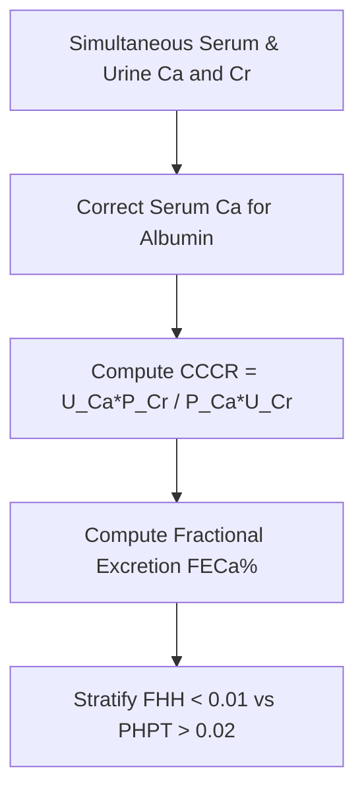

# Renal Calcium-to-Creatinine Clearance Ratio (CCCR) Personal Agent Skill

[](LICENSE)
[](https://www.python.org/)
[]()
[]()
[]()

Deterministic, zero-mock personal agent micro-skill for calculating Calcium-to-Creatinine Clearance Ratio (CCCR) and Fractional Excretion of Calcium (FECa%) to differentiate Familial Hypocalciuric Hypercalcemia (FHH) from Primary Hyperparathyroidism (PHPT).

## Architecture



## Quickstart

```python
from client import CalciumCreatinineClearanceRatioClient

client = CalciumCreatinineClearanceRatioClient()
result = client.evaluate_cccr(
    urine_calcium_mg_dl=4.5,
    serum_creatinine_mg_dl=0.9,
    serum_calcium_mg_dl=10.8,
    urine_creatinine_mg_dl=95.0
)
print(result)
```

## License

Apache-2.0
